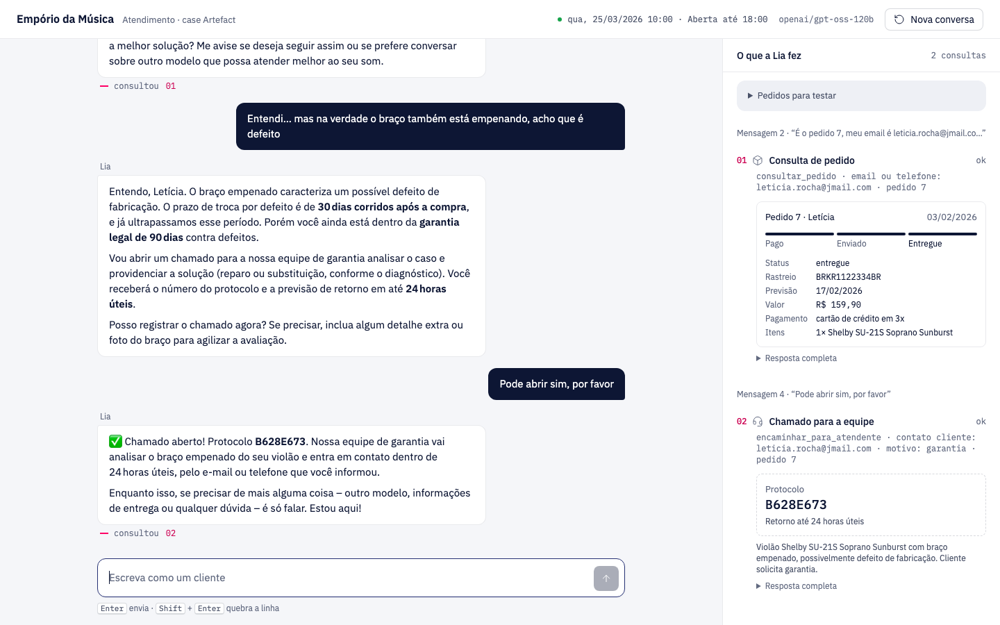
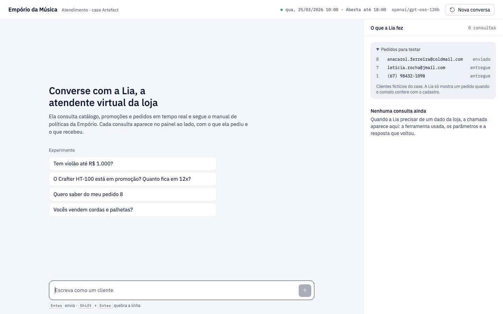
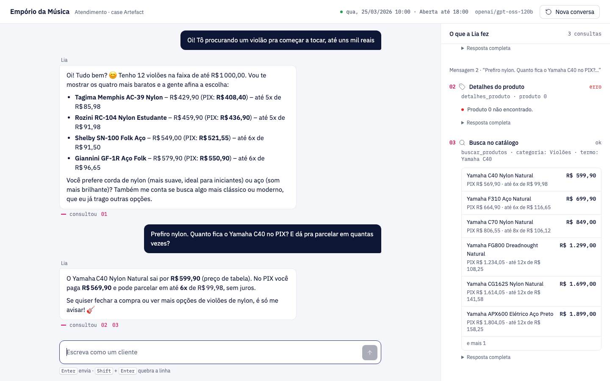

# Empório da Música: assistente de atendimento

Este projeto é a **Lia**, uma assistente virtual para a Empório da Música, uma loja (fictícia) de instrumentos musicais em Campo Grande/MS. Ela conversa com o cliente por texto, como no WhatsApp, e usa os dados reais da loja (planilhas de produtos, promoções e pedidos) e o manual de políticas.



*À esquerda, a conversa. À direita, cada consulta que a Lia fez para responder: qual ferramenta usou, com quais dados e o que voltou.*

O que a Lia faz:

- procura instrumentos e diz preço, estoque e promoções;
- calcula o preço no PIX e em quantas vezes dá para parcelar;
- consulta um pedido, mas só se o cliente provar que é dele;
- responde dúvidas sobre trocas, garantia, frete e horários;
- passa o caso para uma pessoa da equipe quando precisa.

## Como rodar

### 1. Instale o que precisa

- [uv](https://docs.astral.sh/uv/) (gerenciador de Python). No Mac: `brew install uv`.
- Uma chave grátis do Groq, em [console.groq.com/keys](https://console.groq.com/keys).

### 2. Configure a chave

```bash
cp .env.example .env
```

Abra o arquivo `.env` e cole a chave em `GROQ_API_KEY=`. O resto pode ficar como está.

### 3. Instale as dependências

```bash
uv sync
```

### 4. Abra a interface

```bash
uv run emporio-web
```

Depois abra [http://127.0.0.1:8000](http://127.0.0.1:8000) no navegador.

### Outros jeitos de usar

```bash
uv run emporio --debug                     # chat no terminal, mostrando as ferramentas usadas
uv run pytest                              # testes (não gastam chamadas de IA)
uv run python scripts/gerar_conversas.py   # gera de novo as conversas de exemplo
```

## Como usar a interface



1. **Escreva como um cliente** ou clique numa das perguntas de exemplo.
2. **Acompanhe o painel da direita.** Cada consulta aparece numerada (01, 02…), com o resultado desenhado: etiquetas de preço, andamento do pedido, protocolo de chamado. Em "Resposta completa" dá para ver o dado bruto que a Lia recebeu.
3. **Siga a numeração.** Embaixo de cada resposta da Lia aparece "consultou 01": clicar no número destaca a consulta no painel.
4. **Teste um pedido.** O quadro "Pedidos para testar" traz números e contatos dos clientes fictícios. Com o contato errado, a Lia não mostra nada.
5. **Recarregou a página?** A conversa continua de onde parou. "Nova conversa" começa do zero.

Enquanto a Lia trabalha, o balão dela diz o que está fazendo ("Procurando no catálogo"). Se o limite gratuito do Groq estourar, ele mostra quanto tempo falta para liberar.



No celular, o painel de consultas abre pelo botão "Consultas" no topo.


## Como funciona

```
Cliente escreve
     │
     ▼
  Agente  ──────►  Modelo de IA (Groq)
     ▲                  │
     │      "preciso buscar violões até R$ 1.000"
     │                  ▼
     └────────  Ferramentas  ──►  Planilhas da loja (CSV)
```

1. O cliente manda uma mensagem.
2. O agente envia ao modelo: as instruções da Lia (jeito de falar, regras e o manual inteiro), a conversa até ali e a lista das 5 ferramentas.
3. O modelo decide se precisa de algum dado. Se precisar, ele pede uma ferramenta, por exemplo `buscar_produtos(categoria="Violões", preco_max=1000)`.
4. O Python executa a ferramenta: lê as planilhas, filtra, faz as contas e devolve o resultado.
5. O modelo usa o resultado para escrever a resposta. Os passos 3 a 5 podem se repetir até 8 vezes por mensagem.
6. A conversa é salva em `.sessions/`, e a interface recebe cada passo em tempo real.

| O modelo de IA faz | O código Python faz |
|---|---|
| Entende o que o cliente quer | Lê as planilhas |
| Escolhe a ferramenta e os dados de busca | Filtra produtos por nome, categoria e preço |
| Aplica o manual (troca, garantia, frete, horário) | Calcula PIX, parcelas, promoção e prazos de troca |
| Escreve a resposta no tom da Lia | Confere se o pedido é mesmo daquele cliente |
| Recusa assuntos fora da loja | Registra o chamado para a equipe |

As 5 ferramentas são: `buscar_produtos`, `detalhes_produto`, `listar_categorias`, `consultar_pedido` e `encaminhar_para_atendente`.

### Onde fica cada coisa

| Arquivo | O que faz |
|---|---|
| `src/emporio_agent/data.py` | Lê as planilhas e faz todas as contas (PIX, parcelas, prazos de troca, horário da loja) |
| `src/emporio_agent/tools.py` | As 5 ferramentas que a IA pode usar |
| `src/emporio_agent/prompts.py` | As instruções da Lia: jeito de falar, regras e o manual da loja |
| `src/emporio_agent/agent.py` | O vai e volta entre a IA e as ferramentas, as esperas pelo limite do Groq e o histórico |
| `src/emporio_agent/web.py` | O servidor da interface (FastAPI), que manda cada passo para a página em tempo real |
| `src/emporio_agent/static/` | A página: HTML, CSS e JavaScript, sem framework |
| `src/emporio_agent/cli.py` | O chat no terminal |
| `knowledge/politicas.md` | O manual da loja passado do PDF para texto |
| `scripts/gerar_conversas.py` | Roda os cenários de exemplo e salva em `conversas/` |
| `tests/` | Testes das regras de negócio, do agente e da API, sem chamar a IA |

## Por que foi feito assim

**As contas são feitas em Python, não pela IA.**
Modelos de linguagem erram conta com facilidade. Por isso o desconto do PIX, o número de parcelas e os prazos de troca são calculados no código e conferidos pelos testes. A IA só repete o resultado.

**Ferramentas para os dados, manual inteiro nas instruções.**
São só 65 produtos e 20 pedidos, então uma busca simples em Python resolve, sem banco vetorial (RAG). O manual da loja é curto (cerca de 2 mil tokens) e cabe inteiro nas instruções da Lia, então ela sempre tem a regra completa à mão.

**A IA nunca vê a lista de clientes.**
Para consultar um pedido, a ferramenta exige o número do pedido **e** o e-mail ou telefone do dono. Se não bater, não mostra nada, nem confirma se o pedido existe. Isso protege os dados pessoais (LGPD), mesmo que alguém tente enganar a IA.

**Mostrar o que a IA fez, não só o que ela disse.**
Num atendimento automático, quem avalia precisa conferir se a resposta veio dos dados certos. Por isso a interface tem o painel de consultas ao lado do chat, e cada resposta aponta para as consultas que a sustentam.

**Modelo `openai/gpt-oss-120b` no Groq.**
É um modelo aberto, bom em usar ferramentas, e o Groq tem plano gratuito. Dá para trocar o modelo no `.env` (`EMPORIO_MODEL`).

**Feito para caber no plano gratuito.**
O Groq grátis aceita 8 mil tokens por minuto e por chamada. Para caber, a resposta reservada é curta, a busca devolve no máximo 6 produtos e os resultados de consultas antigas vão encurtados para o modelo (o histórico salvo continua completo). Quando o limite estoura, o agente espera o tempo que o Groq pede e avisa a interface.

**Interface simples e sem cara de "feita por IA".**
HTML, CSS e JavaScript puros, servidos pelo próprio Python, sem etapa de build. O visual segue o método [unslop](https://github.com/heydamir/unslop): fundo neutro, uma cor de destaque usada pouco, sem gradientes, brilhos ou emojis na interface. As cores e as fontes (IBM Plex) vêm da identidade da Artefact: azul-marinho para o texto e os botões, e o rosa só na numeração das consultas.

**Data fixa para testes.**
Os dados da loja vão só até março de 2026. A variável `EMPORIO_NOW` congela o relógio da Lia numa data (por padrão 25/03/2026 às 10h), assim as respostas sobre prazos e horário fazem sentido e dá para repetir as conversas.

## O que eu assumi sobre os dados

- O manual tem algumas contradições (dois telefones, dois e-mails, regras de parcelamento diferentes). Escolhi uma versão de cada e expliquei o motivo no fim de `knowledge/politicas.md`.
- Os pedidos não têm a data real de entrega, só a data prevista. Uso a data prevista para contar os 7 dias de arrependimento.
- Algumas categorias (como instrumentos de sopro) existem, mas não têm produto. A Lia diz que não tem no momento, sem inventar modelos.
- Quando um produto tem mais de uma promoção ativa, vale a de maior desconto.

## Exemplos de conversa

Gerados com o modelo de verdade por `scripts/gerar_conversas.py`. Cada um também abre na interface, com o painel de consultas, pelo endereço indicado no topo do arquivo.

| Exemplo | O que mostra |
|---|---|
| [01 · Busca e pagamento](conversas/01-busca-e-pagamento.md) | Busca por faixa de preço, PIX e parcelamento |
| [02 · Promoção que não existe](conversas/02-promocao-inexistente.md) | Transparência quando o cliente cita uma promoção inativa |
| [03 · Pedido, troca e garantia](conversas/03-pedido-troca-e-garantia.md) | Conversa longa: verificação, prazos, manual e chamado para a equipe |
| [04 · Segurança e LGPD](conversas/04-seguranca-e-lgpd.md) | Contato errado e tentativa de manipulação |
| [05 · Fora do catálogo e horário](conversas/05-fora-do-catalogo-e-horario.md) | Categoria vazia, acessórios e horário |

## Limitações e próximos passos

- **Lento no plano grátis do Groq.** Uma resposta com consultas leva de 10 a 60 segundos, porque o agente espera o limite de tokens liberar. Com um plano pago (ou outro provedor), cai para poucos segundos.
- **Conversas muito longas podem passar do limite** de 8 mil tokens por chamada. A interface avisa e sugere começar uma nova conversa. O próximo passo seria resumir as mensagens antigas.
- **Os chamados para atendentes vão para um arquivo** (`.handoffs/chamados.jsonl`), não para um sistema de verdade.
- **As conversas ficam em arquivos JSON** (`.sessions/`). Numa loja real, iriam para um banco de dados, e a interface teria login.
- **Feriados não são considerados** no horário de funcionamento.
- **A resposta chega inteira**, não letra por letra. Os passos intermediários aparecem em tempo real, mas o texto final não é transmitido aos poucos.

## Uso de assistentes de IA

Usei o Claude Code (Anthropic) como par de programação. Ele ajudou a:

- ler o PDF do desafio e as planilhas, e apontar inconsistências nos dados;
- montar o esqueleto do projeto, as ferramentas e os testes;
- trocar a integração para o Groq, criar a interface web e escrever este README;
- rodar as conversas de teste e corrigir o que elas revelaram (por exemplo, o limite de tokens do Groq).

Para o visual da interface, usei como guia a skill [unslop](https://github.com/heydamir/unslop), de Damir Sokolovsky (licença CC BY 4.0).

As decisões de arquitetura, as premissas e a revisão final foram minhas.
